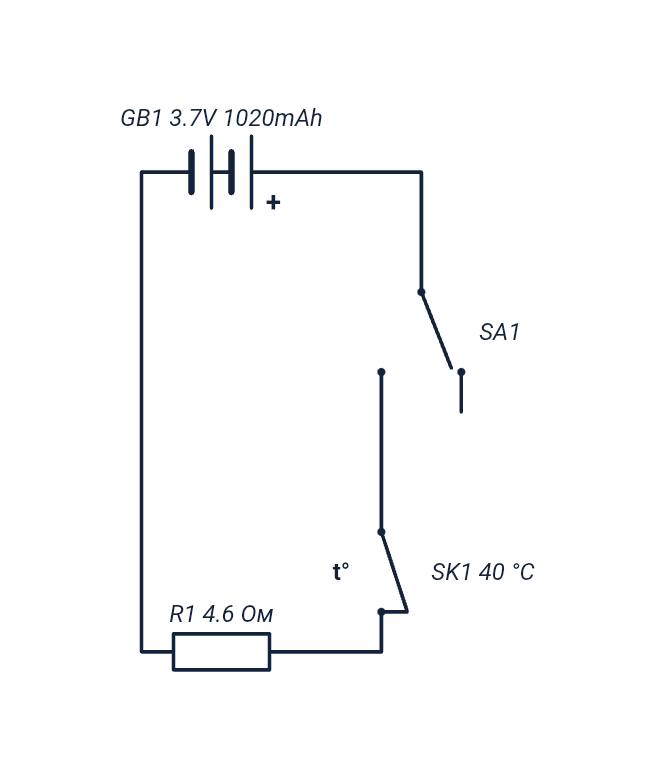

# Pocket Heater

Компактное устройство для локального обогрева (грелка для рук/кармана) с аппаратным ограничением температуры. 
Проект собран на базе доступных компонентов без использования микроконтроллеров (чистая аналоговая логика).

## 🛠 Аппаратные характеристики (Hardware Specs)

| Параметр | Значение | Примечание |
| :--- | :--- | :--- |
| **Источник питания** | Li-Ion аккумулятор 3.7 В, 1020 мАч | Форм-фактор Nokia BL-5C. Зарядка через модуль TP4056 (или аналог от вейпа). |
| **Нагревательный элемент** | Резистор 4.6 Ω | Керамический, мощный (5-10 Вт). |
| **Потребляемая мощность** | ~ 3.7 Вт | При напряжении 4.18 В (полный заряд) ток около 0.9 А. |
| **Защита от перегрева** | Термостат KSD9700 (40 °C) | Нормально замкнутый (NC). Размыкает цепь при достижении 40 °C. |
| **Время работы** | ~ 1.5 - 2 часа | С учетом циклов включения/выключения термостата. |
| **Управление** | Механический тумблер | Разрывает цепь питания. |

## Принципиальная схема


```text
[Аккумулятор 3.7V] ──> [Тумблер] ──> [Термостат 40°C] ──> [Резистор 4.6Ω] ──> [Аккумулятор]
```
## Принцип работы
1. При включении тумблера ток проходит через термостат на нагревательный резистор.
2. Резистор нагревается и передает тепло на медную пластину (теплораспределитель).
3. Когда температура пластины достигает 40 °C, биметаллическая пластина внутри термостата размыкает цепь.
4. Нагрев прекращается. Когда устройство остывает (примерно до 35 °C), термостат снова замыкает цепь.
5. Цикл повторяется, поддерживая комфортную температуру.

## Безопасность

· Термостат исключает перегрев выше 40 °C (защита от ожогов).
· Механический разрыв цепи тумблером гарантирует отключение питания.
· Внимание: У аккумулятора нет встроенной платы BMS, поэтому не рекомендуется разряжать его ниже 3.2 В (следите за нагревом).

## Сборка 

1. Подготовка нагревателя: Припаять провода к резистору 4.6 Ω.
2. Сборка цепи: Соединить последовательно тумблер, термостат и резистор.
3. Теплоотвод: Прижать термостат и резистор к медной пластине (через термопасту или термостойкий скотч) для эффективной передачи тепла.
4. Изоляция: Убедиться, что ножки резистора не замыкают на медь.
5. Корпус: Поместить конструкцию в корпус (например, из пластика или картона) с окном для выхода тепла.

## Планы по улучшению 

☐ Добавить плату защиты BMS для аккумулятора.
☐ Сделать 3D-модель корпуса.
☐ Протестировать время работы в реальных условиях (на улице).
